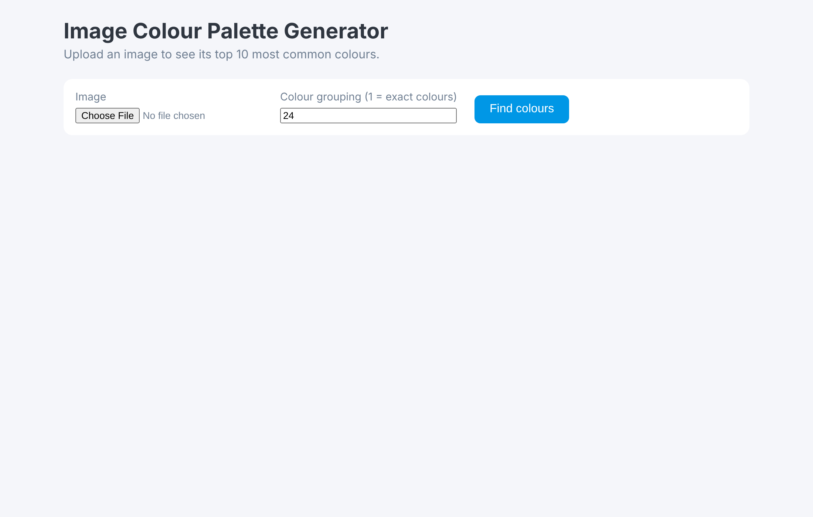
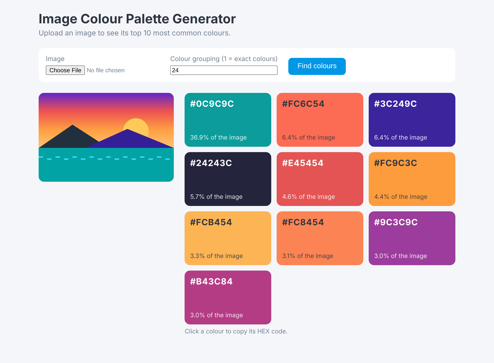

# 🚀 Image Colour Palette Generator

A small website where you upload an image and see its top 10 most common colours
with their HEX codes, counted with NumPy. Day 92 assignment of the 100 Days of
Code Python course.

## 📚 Table of Contents

- [Overview](#-overview)
- [Requirements](#-requirements)
- [Setup](#-setup)
- [Run](#-run)
- [Tests](#-tests)
- [Steps](#-steps)
- [License](#-license)
- [Links](#-links)
- [Appendix: Project documents](#-appendix-project-documents)

## 🧭 Overview

Open the page, choose an image and press **Find colours**. The page shows the
image beside ten swatches, most common first, each with its HEX code and its
share of the image. Click a swatch to copy its HEX code.

How the colours are counted:

1. Pillow decodes the upload and scales it down to at most 300 px on the long
   side, which keeps the proportions of the colours and makes counting fast.
2. NumPy reshapes the image to a list of RGBA pixels and drops the transparent
   ones (alpha below 128).
3. Each channel is grouped into buckets (24 wide by default, 1 to 64), so near-identical
   shades in a photo count as one colour. Set the grouping to 1 to count exact
   colours.
4. `np.unique(..., axis=0, return_counts=True)` counts each colour, and
   `np.argsort` picks the ten most common.

The web server uses only the Python standard library (`http.server`), so the
only runtime dependencies are NumPy and Pillow.

| Folder | What it holds |
| --- | --- |
| `src/colour_palette/domain/` | Colour counting with NumPy (`find_top_colours`) and the `ColourShare` value |
| `src/colour_palette/application/` | The use case: `PaletteService.build_palette` |
| `src/colour_palette/infrastructure/` | Image decoding with Pillow (`PillowImageReader`) |
| `src/colour_palette/presentation/` | The web server, the form parser and the HTML page |
| `src/colour_palette/constants.py` | Every constant: number of colours, bucket size, upload limit, host and port |
| `tests/unit/`, `tests/integration/` | pytest tests; the integration tests run the server on `127.0.0.1` |
| `docs/` | Project documents; `docs/images/` holds the screenshots |
| `docs/use-cases/uc-001-get-colour-palette/` | The use case and its design: DM, SSD, OC, SD and DCD |
| `docs/adr/` | Architecture decisions: standard library web server, downscale and quantise |

The table shows the finished layout: step 2 adds the package, `constants.py`
and a smoke test, step 4 the domain, application and infrastructure layers, and
step 5 the presentation layer.

## 📋 Requirements

| Requirement | Why |
| --- | --- |
| Python 3.14 or newer | The language the project is written in |
| NumPy | Counts the colours (the point of the assignment) |
| Pillow | Reads PNG, JPEG, GIF, BMP and WebP uploads |
| pytest (development only) | Runs the tests |
| Doxygen (optional) | Builds the API documentation from the source comments |

## 🛠️ Setup

Create a local virtual environment in `.venv`, upgrade pip, and install the
project with its test tools.

Linux and macOS:

```bash
python3 -m venv .venv
source .venv/bin/activate
python -m pip install --upgrade pip
python -m pip install -e ".[dev]"
```

Windows (PowerShell):

```powershell
py -3.14 -m venv .venv
.venv\Scripts\Activate.ps1
python -m pip install --upgrade pip
python -m pip install -e ".[dev]"
```

To install only what the app needs to run, use `python -m pip install -e .`.
Leave the environment with `deactivate`. The `.venv` folder is in `.gitignore`.

## ▶️ Run

With the virtual environment active:

```bash
python -m colour_palette
```

Open <http://127.0.0.1:8000> in a browser. Stop the server with `Ctrl+C`.
Use `--port 8080` for another port, or `--host 0.0.0.0` to reach it from other
machines on your network. `colour-palette` is a shortcut for the same command.

Uploads are limited to 10 MB and are never stored; the image is read in memory
and dropped after the page is sent. The server is Python's `http.server`, meant
for local use, not for the open internet (ADR-0001).

## 🧪 Tests

```bash
python -m pytest
```

With coverage: `python -m pytest --cov=colour_palette`.

The tests build their images in memory, read no files and use no network
besides the loopback server started by the integration tests.

Build the API documentation (optional): run `doxygen` in the repository root and
open `docs/doxygen/html/index.html`.

## 🪜 Steps

The project is built in steps, one branch and pull request each. The wiki has a
page per step that explains what was learned.

| Step | Milestone | What it adds | Screenshot |
| --- | --- | --- | --- |
| 1 | MIL-001 Baseline | Business case, stakeholders, project plan and milestones | [01-baseline.png](docs/images/01-baseline.png) |
| 2 | MIL-002 Scaffold | `pyproject.toml`, `constants.py`, smoke test, `.gitignore`, `.editorconfig`, `Doxyfile`, this README | [02-scaffold-tests.png](docs/images/02-scaffold-tests.png) |
| 3 | MIL-003 Design | Use case UC-001, ADR-0001 and ADR-0002, domain model, system sequence diagram, operation contract, sequence diagram and design class diagram | [03-design-use-case.png](docs/images/03-design-use-case.png) |
| 4 | MIL-004 Engine | Pillow image reader, NumPy colour counting (`find_top_colours`), `PaletteService` and their unit tests | [04-engine-tests.png](docs/images/04-engine-tests.png) |
| 5 | MIL-005 Website | Upload form, result page with swatches and HEX codes, error pages, web tests | [05-website-top-ten-colours.png](docs/images/05-website-top-ten-colours.png) |

The website after step 5, the upload page:



The top 10 colours of the sample image (`docs/images/sample-sunset.png`):



## 📄 License

GNU Affero General Public License v3.0 or later, see [LICENSE](LICENSE).

## 🔗 Links

- [Repository][repository]
- [Documentation][documentation]
- [Issue tracker][issues]

## 📎 Appendix: Project documents

| Document | What it tells you |
| --- | --- |
| [AGENTS.md][agents] | The rules agents follow in this repository |
| [Business Case][BC-001] | Why the project exists, its scope and success criteria |
| [Stakeholder Analysis][SA-001] | Who is involved; the stakeholder IDs used for owners and reviewers |
| [Project Plan][PP-001] | The gateways and their schedule |
| [Milestones][milestones] | One document per gateway: Go/No-Go criteria and tasks |
| [Use case UC-001][UC-001] | The user goal and its design diagrams |
| [Design Class Diagram][DCD-002] | The classes and layers of the code |
| [Artifact registry][registry] | Where each artifact type lives, the next version, the PO language and domain |
| [Framework README][framework-readme] | The framework this project uses |
| [Framework changelog][framework-changelog] | What changed in each framework release |

---

[repository]: https://git.tirsystem.com/Tirsvad-Udemy-100-days-of-code/092-assignment-image-colour-palette-generator
[documentation]: https://git.tirsystem.com/Tirsvad-Udemy-100-days-of-code/092-assignment-image-colour-palette-generator/wiki
[issues]: https://git.tirsystem.com/Tirsvad-Udemy-100-days-of-code/092-assignment-image-colour-palette-generator/issues
[agents]: ./AGENTS.md
[BC-001]: ./docs/business-case.md
[SA-001]: ./docs/stakeholder-analysis.md
[PP-001]: ./docs/project-plan.md
[milestones]: ./docs/milestones/
[UC-001]: ./docs/use-cases/uc-001-get-colour-palette/uc.md
[DCD-002]: ./docs/dcd.md
[registry]: ./docs/artifact-registry.md
[framework-readme]: ./framework/README.md
[framework-changelog]: ./framework/CHANGELOG.md
