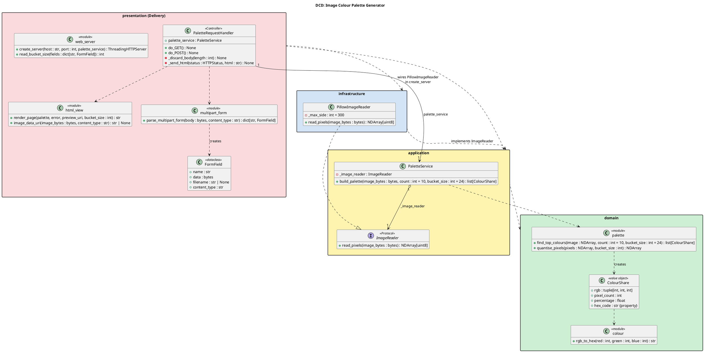

# Design Class Diagram: Image Colour Palette Generator

## Metadata

| Key | Value |
| --- | --- |
| ID | DCD-002 |
| CrossReference | [DCD-001], [DM-002], [SD-001], [OC-001] |

## Version History

| Date | Status | Author | Reviewer | Change | Commit |
| --- | --- | --- | --- | --- | --- |
| 2026-11-21 | Proposed | S01 | S01 | First edition: adds the design of DCD-001 (UC-001) | [1674101] |
| 2026-11-21 | Accepted | S01 | S01 | Accepted after review RC-019 Go; stand-in review, not independent | [1674101] |

---

## Purpose

The project Design Class Diagram, the consolidated design of every use case. It holds the additions of [DCD-001] (UC-001): the classes, functions and packages that implement [UC-001], one package per
clean architecture layer. Answers CN-003 and CN-005 for S02 and S03.

## Diagram

## Mapping to the Domain Model

| Domain concept | Design element |
| --- | --- |
| Image | `bytes` of the upload, read by `PillowImageReader` |
| Pixel | one row of the NumPy array (red, green, blue, alpha) |
| Colour | `rgb` and `hex_code` of `ColourShare`; `rgb_to_hex` |
| Colour Step | `bucket_size` (1 to 64, default 24) |
| Palette | `list[ColourShare]`, most common first; no own class because it has no behaviour |
| Palette Entry | `ColourShare` (rank is the position in the list, share is `percentage`) |

## Design Notes

- Dependencies point inward: `domain` imports nothing from the other layers;
  `application` owns the `ImageReader` protocol (dependency inversion);
  `infrastructure` implements it; `presentation` wires the parts in
  `create_server` (composition root).
- Every constant lives in `constants.py` (`TOP_COLOUR_COUNT`, `MAX_IMAGE_SIDE`,
  `MAX_UPLOAD_BYTES`, `MIN_VISIBLE_ALPHA`, bucket limits).
- Exceptions: `InvalidImageError` (infrastructure), `PaletteError` (application),
  `FormParseError` (presentation); all extend `ValueError`.
- Method signatures trace to [SD-001] and [OC-001].

---

[DCD-001]: use-cases/uc-001-get-colour-palette/dcd.md
[DM-002]: domain-model.md
[SD-001]: use-cases/uc-001-get-colour-palette/sd.md
[OC-001]: use-cases/uc-001-get-colour-palette/oc.md
[1674101]: https://git.tirsystem.com/Tirsvad-Udemy-100_days_of_code/092-assignment-image-colour-palette-generator/commit/1674101ae5f672f315e1c957308be6323d829faf
