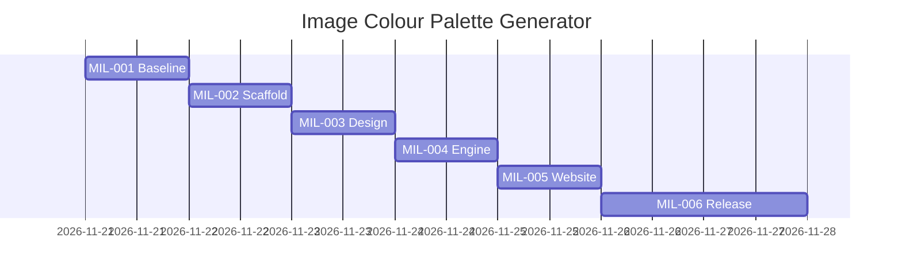

# Project Plan: Image Colour Palette Generator

## Metadata

| Key | Value |
| --- | --- |
| ID | PP-001 |
| CrossReference | [BC-001], [SA-001], [MIL-001], [MIL-002], [MIL-003], [MIL-004], [MIL-005], [MIL-006] |
| Language | en |
| Domain | it |

## Version History

| Date | Status | Author | Reviewer | Change | Commit |
| --- | --- | --- | --- | --- | --- |
| 2026-11-21 | Proposed | S01 | S01 | First edition: six milestones, one branch and pull request each | pending |
| 2026-11-21 | Accepted | S01 | S01 | Accepted by S01 in chat on 2026-11-21; review RC-003 Go, stand-in, not independent | pending |

---

## Window and Constraint

- Start: 2026-11-21. End: 2026-11-28.
- Constraint: the course budget of about 180 minutes for the build (BC-001
  Cost-Benefit), plus documentation time; one developer (S01).

## Schedule

| Gateway | Document | Decision date | Owner | Reviewer | Main deliverable | User stories | Issue-tracker milestone |
| --- | --- | --- | --- | --- | --- | --- | --- |
| MIL-001 Baseline | [MIL-001] | 2026-11-22 | S01 | S01 | BC-001, SA-001, PP-001 and MIL-001 to MIL-006, each with a `Go` review record | none (planning) | not yet synced |
| MIL-002 Scaffold | [MIL-002] | 2026-11-23 | S01 | S01 | A repository that installs into a `.venv`, runs an empty pytest suite green and passes opengrep | none (technical tasks) | not yet synced |
| MIL-003 Design | [MIL-003] | 2026-11-24 | S01 | S01 | UC-001 with its DM, SSD, OC, SD and DCD, and ADRs for the web server and the colour quantisation, each with a `Go` review | UC-001 (use case instead of stories) | not yet synced |
| MIL-004 Engine | [MIL-004] | 2026-11-25 | S01 | S01 | The domain module that turns image bytes into the top 10 colours as HEX with their share, with unit tests | UC-001 | not yet synced |
| MIL-005 Website | [MIL-005] | 2026-11-26 | S01 | S01 | A standard-library `http.server` website with an upload form and a result page of swatches with HEX codes, with web tests | UC-001 | not yet synced |
| MIL-006 Release | [MIL-006] | 2026-11-28 | S01 | S01 | The complete wiki in en, da and ms, the reflection journal, the final README and a tagged release | none (documentation) | not yet synced |

## Scope Coverage

| Business Case in-scope item | Gateway |
| --- | --- |
| Upload form | MIL-005 |
| Colour extraction with NumPy | MIL-004 |
| Result page with swatches, HEX and share | MIL-005 |
| Colour step setting | MIL-004 (engine), MIL-005 (form) |
| Error messages | MIL-005 |
| Unit and web tests | MIL-004, MIL-005 |
| Project files, doxygen, README | MIL-002 |
| Wiki, screenshots, reflection | every milestone (step page), MIL-006 (complete) |
| Repository description and topics | MIL-001 (create), MIL-006 (check) |

## Dependencies

MIL-001 -> MIL-002; MIL-001 -> MIL-003 -> MIL-004 -> MIL-005 -> MIL-006;
MIL-002 -> MIL-004. The chain is acyclic and matches the schedule order.

## No-Go Rule

A No-Go stops the gateway; its findings are fixed on the same branch and the
gateway is reviewed again. Later gateways move by the same number of days.
The end date may move up to 7 days; S01 decides any move. Three No-Go rounds on
the same gateway stop the run and go to S01 for a decision.

## Way of Working

- One branch `milestone/mil-NNN-<slug>` and one pull request per milestone,
  closing its issues.
- Before each push: `pytest`, then opengrep on S01's computer
  (`~\.opengrep\cli\latest\opengrep.exe scan .`), 0 findings required.
- Each milestone adds its screenshot to `docs/images/`, the README step list
  and a wiki step page in en, da and ms.
- Tokens are read from `.env` by the tools only; `.env` is never committed,
  imported or tested.

## Planning Assumptions

| ID | Assumption | Source |
| --- | --- | --- |
| PA-1 | One gateway per working day is enough for this small scope | BC-001 Cost-Benefit |
| PA-2 | Pushing to git.tirsystem.com and running opengrep happen on S01's computer | Project goal (opengrep path), host reachable only from there |
| PA-3 | Python 3.14 is installed on S01's computer | BC-001 AS-6 |

## Plan Risks

| ID | Risk | Impact | Mitigation | From |
| --- | --- | --- | --- | --- |
| PR-1 | The design gateway takes longer than the code it describes | Schedule slip | One use case, short artifacts | BC-001 R-5 |
| PR-2 | The git host or opengrep is not reachable when a push is due | Gateway waits | Work continues on the next branch locally; push when reachable | PA-2 |
| PR-3 | Translations lag behind the English pages | QC-WIKI-001 fails | A step page is not done until all three languages exist | BC-001 R-5 |

## Open Issues

None. OI-1 (prompt log) was closed on 2026-11-21: S01 accepted the plan with the proposal, so this repository keeps no prompt log.

---

[BC-001]: ./business-case.md
[SA-001]: ./stakeholder-analysis.md
[MIL-001]: ./milestones/mil-001-baseline.md
[MIL-002]: ./milestones/mil-002-scaffold.md
[MIL-003]: ./milestones/mil-003-design.md
[MIL-004]: ./milestones/mil-004-engine.md
[MIL-005]: ./milestones/mil-005-website.md
[MIL-006]: ./milestones/mil-006-release.md
