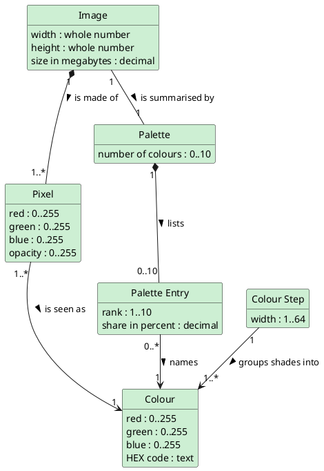

# Domain Model: UC-001 Get the colour palette of an image

## Metadata

| Key | Value |
| --- | --- |
| ID | DM-001 |
| CrossReference | [UC-001], [SSD-001], [DM-002] |
| Language | en |
| Domain | it |

## Version History

| Date | Status | Author | Reviewer | Change | Commit |
| --- | --- | --- | --- | --- | --- |
| 2026-11-21 | Proposed | S01 | S01 | First edition | [b857418] |
| 2026-11-21 | Accepted | S01 | S01 | Accepted after review RC-013 Go; stand-in review, not independent | [b857418] |

---

## Purpose

The concepts of UC-001 in the visitor's words, so the design and the code name
things the way S02 participants read them (CN-003, CN-004).

## Diagram

## Concepts

| Concept | Meaning | Source |
| --- | --- | --- |
| Image | The picture the visitor gives | UC-001 steps 1 and 3 |
| Pixel | One dot of the image with its colour and opacity; a pixel with opacity below 128 is transparent | UC-001 step 3, BR-1 |
| Colour | A colour a person sees, written as a HEX code | UC-001 steps 4 and 5 |
| Colour Step | How close two shades must be to count as one colour | UC-001 step 1, BR-2 |
| Palette | The most common colours of one image | UC-001 step 5, BR-3 |
| Palette Entry | One colour of the palette, its rank and how much of the image it covers | UC-001 step 5 |

---

[UC-001]: uc.md
[SSD-001]: ssd.md
[DM-002]: ../../domain-model.md
[b857418]: https://git.tirsystem.com/Tirsvad-Udemy-100_days_of_code/092-assignment-image-colour-palette-generator/commit/b857418b24c89c414391edbb11e90d3fa7b5c695
