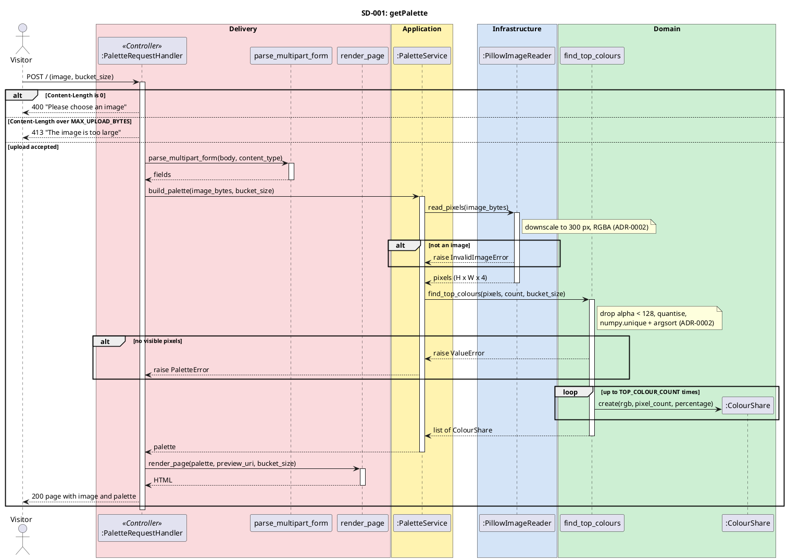

# Sequence Diagram: getPalette

## Metadata

| Key | Value |
| --- | --- |
| ID | SD-001 |
| CrossReference | [OC-001], [DCD-001], [ADR-0001], [ADR-0002] |

## Version History

| Date | Status | Author | Reviewer | Change | Commit |
| --- | --- | --- | --- | --- | --- |
| 2026-11-21 | Proposed | S01 | S01 | First edition | pending |
| 2026-11-21 | Accepted | S01 | S01 | Accepted after review RC-016 Go; stand-in review, not independent | pending |

---

## Purpose

How the classes realise the postconditions of [OC-001] `getPalette`, grouped by
the clean architecture layers. Answers CN-002 (where NumPy does the work) and
CN-003 (readable names) for S01 and S02.

## Diagram

## Notes

- GRASP Controller: `PaletteRequestHandler` receives the system operation and
  only delegates; `PaletteService` is the use case controller.
- The application layer owns the `ImageReader` protocol; `PillowImageReader`
  implements it, so calls from Application to Infrastructure go through the inner
  layer's interface.
- The exceptions of OC-001 are the `alt` fragments; each ends in an error page
  (status 400 or 413) rendered by `render_page(error=...)`.

---

[OC-001]: oc.md
[DCD-001]: dcd.md
[ADR-0001]: ../../adr/adr-0001-standard-library-web-server.md
[ADR-0002]: ../../adr/adr-0002-downscale-and-quantise.md
