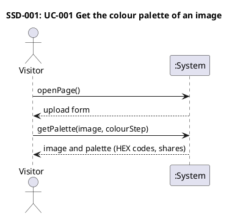
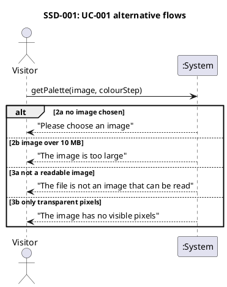

# System Sequence Diagram: UC-001 Get the colour palette of an image

## Metadata

| Key | Value |
| --- | --- |
| ID | SSD-001 |
| CrossReference | [UC-001], [DM-001], [OC-001] |
| Language | en |
| Domain | it |

## Version History

| Date | Status | Author | Reviewer | Change | Commit |
| --- | --- | --- | --- | --- | --- |
| 2026-11-21 | Proposed | S01 | S01 | First edition | pending |
| 2026-11-21 | Accepted | S01 | S01 | Accepted after review RC-014 Go; stand-in review, not independent | pending |

---

## Purpose

The system operations of [UC-001] Get the colour palette of an image, with the
system as a black box.

## Main Success Scenario

Steps 1 and 2 of UC-001 are the `getPalette` message; steps 3 to 5 are its return.
Step 6 (copying a HEX code) happens in the visitor's browser and asks nothing of
the system.

## Alternative Flows

Flow 5a needs no own diagram: the return of `getPalette` simply lists fewer than
ten colours.

---

[UC-001]: uc.md
[DM-001]: dm.md
[OC-001]: oc.md
